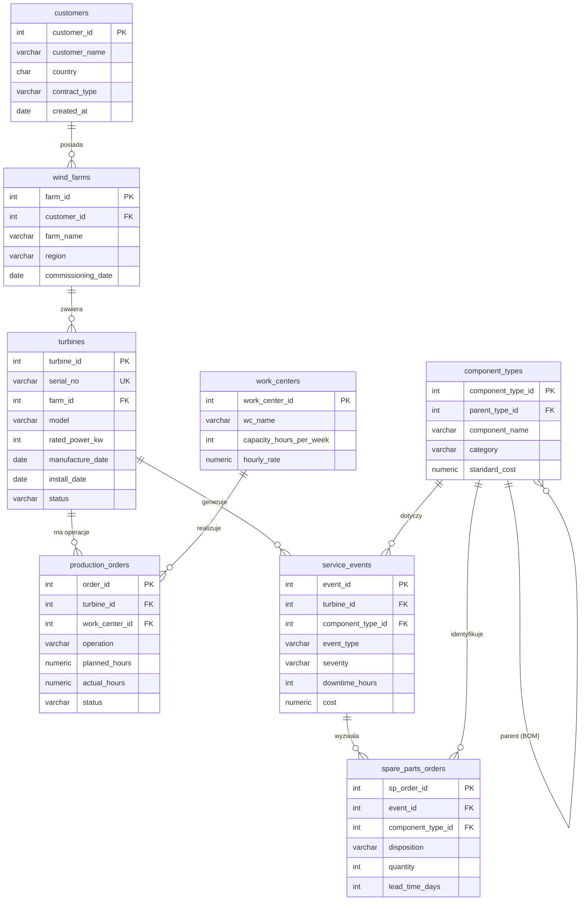

# Wind Turbine Manufacturing & O&M — SQL Analytics

Projekt analityczny SQL na syntetycznej bazie symulującej producenta turbin
wiatrowych: produkcję (montaż job-shop, każda turbina to osobny przypadek) oraz
serwis O&M w polu (awarie, przeglądy, dostępność, koszty, części zamienne).

Dane są w pełni fikcyjne — nazwy, numery seryjne, daty, koszty i zdarzenia zostały
wygenerowane losowo. Baza nie odwzorowuje żadnej realnej firmy.

Stack: PostgreSQL.

## Schemat bazy (ERD)



## Tabele

| Tabela | Opis | Wierszy |
|---|---|---|
| `customers` | Operatorzy / właściciele farm | 60 |
| `wind_farms` | Farmy wiatrowe | 250 |
| `turbines` | Turbiny jako aktywa (cykl życia) | 8 000 |
| `component_types` | Struktura wyrobu BOM (samoreferencja, 4 poziomy) | 45 |
| `work_centers` | Stanowiska produkcyjne + zdolność | 16 |
| `production_orders` | Operacje montażu: plan vs wykonanie | 64 000 |
| `service_events` | Serwis O&M: downtime, koszty (2013–2025) | 287 446 |
| `spare_parts_orders` | Dyspozycje i zamówienia części | 186 934 |

Łącznie ~0,55 mln wierszy.

## Jak uruchomić

```bash
# 1. utwórz bazę
createdb wind_turbine_db

# 2. schemat
psql -d wind_turbine_db -f schema.sql

# 3. dane — najpierw podmień /ABSOLUTNA/SCIEZKA/ na ścieżkę do katalogu z CSV
psql -d wind_turbine_db -f import_data.sql
```

W pgAdmin użyj `import_data_pgadmin.sql` (polecenie `COPY` zamiast `\copy`).

## Analizy

Katalog `queries/` — śledztwo kosztowe floty: które turbiny i komponenty generują
koszty serwisu i gdzie szukać oszczędności (CTE, funkcje okienkowe, normalizacja).
